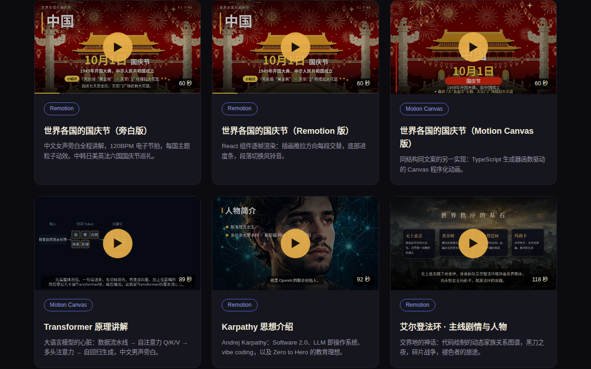

<p align="right"><a href="README.md">中文</a></p>

<p align="center">
  
</p>

<p align="center">
  <a href="https://holynova.github.io/video-gallery/">▶ Watch Online</a>
  ·
  <a href="https://github.com/holynova/video-gallery">GitHub Repository</a>
</p>

Video Gallery is a showcase of short films rendered entirely in code: 6 films generated frame by frame with Remotion and Motion Canvas — from a tour of six countries' National Days, to a visual explainer of the Transformer attention mechanism, to an Elden Ring mythology chronicle. Click any card to play in a lightbox, full screen.

## Screenshots

<p align="center">
  
</p>

<p align="center">
  
</p>

## The Films

| Film | Length | Engine | About |
|------|--------|--------|-------|
| 世界各国的国庆节（旁白版） *National Days Around the World* (Narration Edition) ⭐ | 60s | Remotion | A Chinese female narrator throughout, a 120 BPM electronic beat, themed particle effects per country; a tour of China, Korea, Japan, the US, the UK, and France |
| 世界各国的国庆节（Remotion 版） *National Days Around the World* (Remotion Edition) | 60s | Remotion | React components rendered frame by frame: illustration push-pull direction alternates per segment, a progress bar at the bottom, wind-chime sounds on segment changes |
| 世界各国的国庆节（Motion Canvas 版） *National Days Around the World* (Motion Canvas Edition) | 60s | Motion Canvas | The same structure and script in another implementation: procedural Canvas animation driven by TypeScript generator functions |
| Transformer 原理讲解 *How the Transformer Works* | 89s | Motion Canvas | Data pipeline → self-attention Q/K/V → multi-head attention → autoregressive generation, with a Chinese male narrator |
| Karpathy 思想介绍 *Karpathy's Ideas* | 92s | Remotion | Software 2.0, LLMs as operating systems, vibe coding, and the Zero to Hero educational vision |
| 艾尔登法环 · 主线剧情与人物 *Elden Ring: Main Story & Characters* | 118s | Remotion | The mythology of the Lands Between: a code-drawn animated family tree, the Night of the Black Knives, the Shattering, and the Tarnished's journey |

The three National Days editions are three implementations of the same subject, placed side by side to compare the two engines' visual style and pacing.

## How the Films Are Made

- **Remotion**: write video with React — components describe each frame's content, rendered frame by frame into MP4. 4 films were made with it; it excels at image layouts, pull-quotes, and relationship graphs.
- **Motion Canvas**: a TypeScript + Canvas procedural animation library with generator-function syntax and built-in live preview. The Transformer explainer uses it to draw animated attention links and probability bars.
- **AI illustrations**: every film's illustrations were generated by image models — travel-poster style, dark tech style, dark-fantasy oil-painting style. No text is placed inside the images; subtitles are overlaid by video code afterwards so Chinese stays crisp.

## Run Locally

No build step — just open the static files:

```bash
open index.html
# Or start a static server: python3 -m http.server 8000
```

## Tech

- A single-page app: one `index.html` (styles + interaction all in-page), zero build, zero dependencies.
- 6 MP4s in `videos/`, 6 posters in `posters/`; the card grid is rendered from JS data, and clicking a card opens a lightbox (Esc or click outside to close).
- A dark cinema theme: ink-black background with gold accents, responsive on mobile (the featured-film area stacks vertically on small screens).

```
index.html          Entry: homepage hero, featured film, all-films grid, how-it's-made notes, lightbox
videos/             6 MP4s (National Days ×3, Transformer, Karpathy, Elden Ring)
posters/            6 posters (video covers)
assets/             Old screenshots and QR codes (kept)
```
