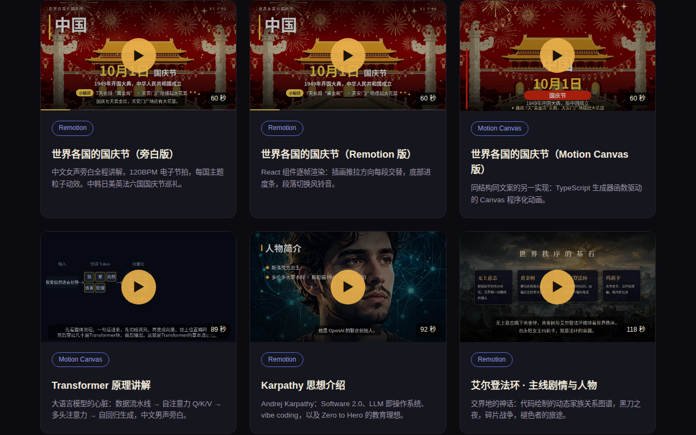

<p align="center">
  
</p>

<p align="center">
  <a href="https://holynova.github.io/video-gallery/">▶ 在线观看 Watch Online</a>
  ·
  <a href="https://github.com/holynova/video-gallery">GitHub 仓库</a>
</p>

光影集是一座用代码与 AI 绘画制作的短视频作品展：6 部短片，全部由 Remotion 与 Motion Canvas 两套代码渲染引擎逐帧生成——从中韩日美英法六国的国庆节巡礼，到 Transformer 注意力机制的可视化讲解，再到艾尔登法环的神话编年史。点击任意卡片，灯箱播放，全屏欣赏。

Video Gallery is a showcase of short films rendered entirely in code: 6 films generated frame by frame with Remotion and Motion Canvas — from a tour of six countries' National Days, to a visual explainer of the Transformer attention mechanism, to an Elden Ring mythology chronicle. Click any card to play in a lightbox, full screen.

## 截图 / Screenshots

<p align="center">
  
</p>

<p align="center">
  
</p>

## 作品 / The Films

| 作品 | 时长 | 引擎 | 内容 |
|------|------|------|------|
| 世界各国的国庆节（旁白版）⭐ | 60 秒 | Remotion | 中文女声旁白全程讲解，120BPM 电子节拍，每国主题粒子动效；中韩日美英法六国巡礼 |
| 世界各国的国庆节（Remotion 版） | 60 秒 | Remotion | React 组件逐帧渲染：插画推拉方向每段交替，底部进度条，段落切换风铃音 |
| 世界各国的国庆节（Motion Canvas 版） | 60 秒 | Motion Canvas | 同结构同文案的另一实现：TypeScript 生成器函数驱动的 Canvas 程序化动画 |
| Transformer 原理讲解 | 89 秒 | Motion Canvas | 数据流水线 → 自注意力 Q/K/V → 多头注意力 → 自回归生成，中文男声旁白 |
| Karpathy 思想介绍 | 92 秒 | Remotion | Software 2.0、LLM 即操作系统、vibe coding，以及 Zero to Hero 的教育理想 |
| 艾尔登法环 · 主线剧情与人物 | 118 秒 | Remotion | 交界地的神话：代码绘制的动态家族关系图谱，黑刀之夜，碎片战争，褪色者的旅途 |

三版国庆节是同一题材的三种实现，放在一起正好对比两套引擎的画风与节奏。

## 这些视频是怎么做的 / How the Films Are Made

- **Remotion**：用 React 写视频，组件描述每一帧的内容，逐帧渲染成 MP4。4 部作品用它制作，擅长图片排版、金句与关系图谱。
- **Motion Canvas**：TypeScript + Canvas 的程序化动画库，生成器函数写法，自带实时预览。Transformer 讲解用它绘制了动态的注意力连线与概率条形图。
- **AI 配图**：每支视频的插画均由图像模型生成：旅行海报风、深色科技风、黑暗奇幻油画风。图内不放文字，字幕由视频代码后期叠加，保证中文清晰。

## 本地运行 / Run Locally

零构建，静态文件直接打开即可：

```bash
open index.html
# 或起一个静态服务器：python3 -m http.server 8000
```

## 技术 / Tech

- 单页应用：一个 `index.html`（样式 + 交互全在页内），零构建、零依赖。
- 6 支 MP4 在 `videos/`，6 张海报在 `posters/`；卡片网格由 JS 数据驱动渲染，点击打开灯箱（Esc / 点击空白处关闭）。
- 深色影院主题：墨底 + 金色点缀，移动端自适应（主打作品区小屏自动上下排布）。

```
index.html          入口：首页 hero、主打作品、全部作品网格、制作说明、灯箱
videos/             6 支 MP4（国庆 ×3、Transformer、Karpathy、艾尔登法环）
posters/            6 张海报（视频封面）
assets/             旧截图与二维码（保留）
```

## English

**Video Gallery** is a showcase of short films rendered entirely in code. Six films, generated frame by frame with two programmatic engines — Remotion (4 films) and Motion Canvas (2 films) — with AI-generated illustrations and Chinese narration or subtitles.

- **The films**: three versions of *National Days Around the World* (narration / Remotion / Motion Canvas editions, 60s each), *How the Transformer Works* (89s), *Karpathy's Ideas* (92s), and *Elden Ring: Main Story & Characters* (118s).
- **How they're made**: Remotion renders React components frame by frame into MP4; Motion Canvas drives Canvas animation with TypeScript generator functions. Illustrations are AI-generated; text is overlaid by code afterwards so Chinese stays crisp.
- **Watch**: click any card to play in a lightbox (Esc or click outside to close). No build step — open `index.html` or serve the folder statically.
- **Tech**: a single `index.html`, zero dependencies; MP4s in `videos/`, posters in `posters/`.
